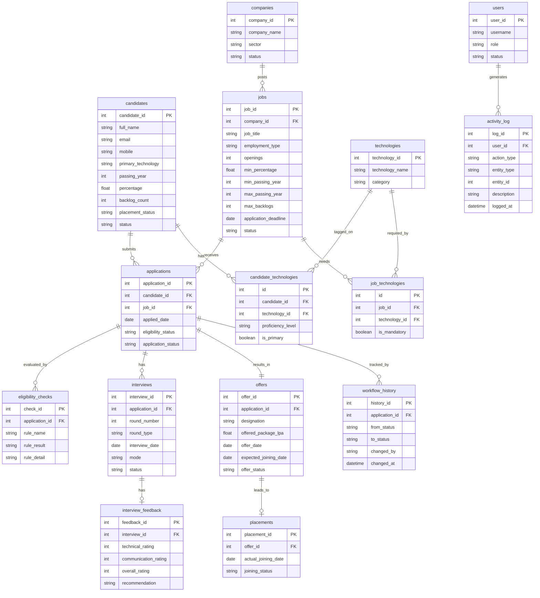

# 📐 RPMS — Entity-Relationship Diagram

**Project:** Recruitment & Placement Management System  
**Total Tables:** 15  

---

## 1. Tables & Purposes

| # | Table Name               | Purpose                                                                 |
|---|--------------------------|-------------------------------------------------------------------------|
| 1 | `candidates`             | Core candidate profile: personal info, education, eligibility attributes |
| 2 | `companies`              | Recruiting company master (name, sector, contact, status)               |
| 3 | `jobs`                   | Job postings with eligibility criteria and open/close status            |
| 4 | `applications`           | Links a candidate to a job; holds eligibility_status and app workflow status |
| 5 | `eligibility_checks`     | Detailed per-rule eligibility evaluation records for each application   |
| 6 | `interviews`             | Interview round records (round number, type, date, mode, interviewer)   |
| 7 | `interview_feedback`     | Ratings and recommendation recorded after each interview round          |
| 8 | `offers`                 | Offer letters: designation, package, dates, offer status                |
| 9 | `placements`             | Actual joining record; confirms whether candidate JOINED                |
| 10| `workflow_history`       | Full audit trail of every application status transition                 |
| 11| `technologies`           | Master list of technologies (Java, Python, SQL, etc.)                   |
| 12| `candidate_technologies` | Junction: many-to-many between candidates and technologies              |
| 13| `job_technologies`       | Junction: many-to-many between jobs and required technologies           |
| 14| `users`                  | System users: admin / recruiter / viewer with hashed passwords          |
| 15| `activity_log`           | System-level action audit log (who did what and when)                   |

---

## 2. Relationships (Text Description)

```
candidates (1) ──────────────────────────── (M) candidate_technologies
technologies (1) ────────────────────────── (M) candidate_technologies

companies (1) ───────────────────────────── (M) jobs

jobs (1) ────────────────────────────────── (M) job_technologies
technologies (1) ────────────────────────── (M) job_technologies

candidates (1) ──────────────────────────── (M) applications
jobs (1) ────────────────────────────────── (M) applications

applications (1) ────────────────────────── (M) eligibility_checks
applications (1) ────────────────────────── (M) interviews
applications (1) ────────────────────────── (1) offers
applications (1) ────────────────────────── (M) workflow_history

interviews (1) ──────────────────────────── (1) interview_feedback

offers (1) ──────────────────────────────── (1) placements

users (1) ───────────────────────────────── (M) activity_log
```

---

## 3. Key Columns Per Table

### `candidates`
```
candidate_id (PK), full_name, email (UNIQUE), mobile (UNIQUE),
date_of_birth, gender, primary_technology, passing_year,
percentage, backlog_count, placement_status, status, created_at
```

### `companies`
```
company_id (PK), company_name, sector, contact_person,
contact_email, contact_phone, website, status, created_at
```

### `jobs`
```
job_id (PK), company_id (FK→companies), job_title,
employment_type, location, openings, min_package_lpa,
max_package_lpa, min_percentage, min_passing_year,
max_passing_year, max_backlogs, posted_date,
application_deadline, status, created_at
```

### `applications`
```
application_id (PK), candidate_id (FK→candidates),
job_id (FK→jobs), applied_date, eligibility_status,
eligibility_reason, application_status, created_at
UNIQUE(candidate_id, job_id)
```

### `eligibility_checks`
```
check_id (PK), application_id (FK→applications),
rule_name, rule_result (PASS/FAIL), rule_detail, checked_at
```

### `interviews`
```
interview_id (PK), application_id (FK→applications),
round_number, round_type (APTITUDE/TECHNICAL/MANAGERIAL/HR),
interview_date, interview_time, mode (ONLINE/OFFLINE/TELEPHONIC),
interviewer_name, status, created_at
```

### `interview_feedback`
```
feedback_id (PK), interview_id (FK→interviews, UNIQUE),
technical_rating (0-5), communication_rating (0-5),
problem_solving_rating (0-5), overall_rating (0-5),
recommendation (NEXT_ROUND/SELECTED/REJECTED/ON_HOLD),
remarks, created_at
```

### `offers`
```
offer_id (PK), application_id (FK→applications, UNIQUE),
designation, offered_package_lpa, offer_date,
expected_joining_date, offer_status (OFFERED/ACCEPTED/REJECTED/EXPIRED/WITHDRAWN),
created_at
```

### `placements`
```
placement_id (PK), offer_id (FK→offers, UNIQUE),
actual_joining_date, joining_status (JOINED/NOT_JOINED/DEFERRED/NO_SHOW),
created_at
```

### `workflow_history`
```
history_id (PK), application_id (FK→applications),
from_status, to_status, changed_by, changed_at, remarks
```

### `technologies`
```
technology_id (PK), technology_name (UNIQUE), category, created_at
```

### `candidate_technologies`
```
id (PK), candidate_id (FK→candidates), technology_id (FK→technologies),
proficiency_level (BEGINNER/INTERMEDIATE/ADVANCED), is_primary
UNIQUE(candidate_id, technology_id)
```

### `job_technologies`
```
id (PK), job_id (FK→jobs), technology_id (FK→technologies),
is_mandatory
UNIQUE(job_id, technology_id)
```

### `users`
```
user_id (PK), username (UNIQUE), password_hash, full_name,
email (UNIQUE), role (ADMIN/RECRUITER/VIEWER), status, created_at
```

### `activity_log`
```
log_id (PK), user_id (FK→users, nullable), action_type,
entity_type, entity_id, description, logged_at
```

---

## 4. Mermaid ER Diagram



---

## 5. Cardinality Summary

| Relationship                           | Cardinality |
|----------------------------------------|-------------|
| Company → Jobs                         | 1 : Many    |
| Candidate → Applications               | 1 : Many    |
| Job → Applications                     | 1 : Many    |
| Application → Eligibility Checks       | 1 : Many    |
| Application → Interviews               | 1 : Many    |
| Application → Offer                    | 1 : 1 (max) |
| Application → Workflow History         | 1 : Many    |
| Interview → Interview Feedback         | 1 : 1 (max) |
| Offer → Placement                      | 1 : 1 (max) |
| Candidate ↔ Technologies (via junction)| M : M       |
| Job ↔ Technologies (via junction)      | M : M       |
| User → Activity Log                    | 1 : Many    |
